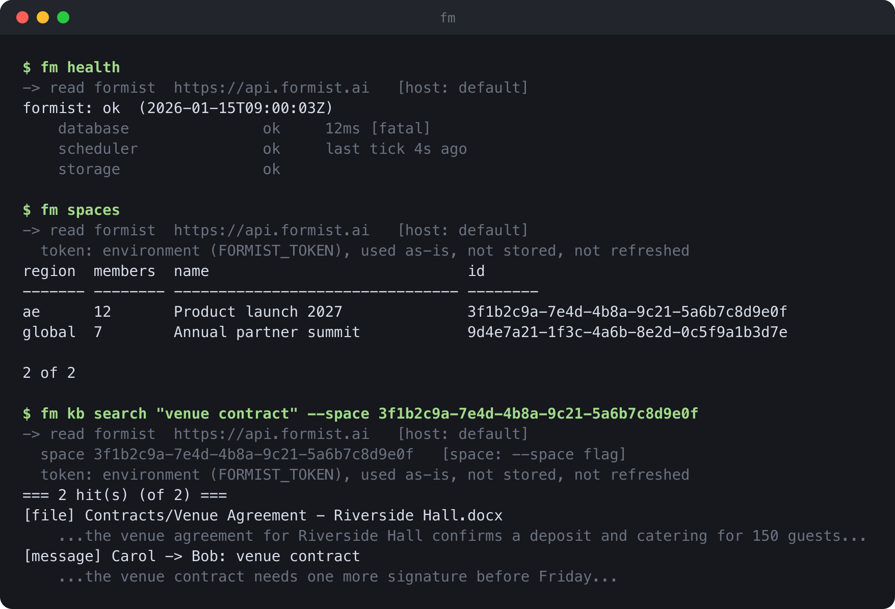

[English](README.md) · [简体中文](README.zh-CN.md) · [Français](README.fr.md) · **العربية**

<div dir="rtl">

# formist-cli

**`fm` عميل طرفي لنشرات [Formist](https://formist.ai) و[Evane](https://evane.ai)، يمر
بنفس الواجهة البرمجية وطريقة تسجيل الدخول التي يستخدمها تطبيق الويب بالضبط.**



<sub>بيانات تجريبية، معروضة بكود `fm` الحقيقي عبر `python3 scripts/render_screenshot.py`.</sub>

---

## المشكلة

تشغيل نشرة Formist أو Evane يوميًا يعني سؤالها أسئلة صغيرة لكن عاجلة طوال الوقت: هل هذه
المنطقة سليمة، هل توقف أحد الموصلات، هل انتشرت ترحيلة الأمس في كل مكان، ولأي عميل تعود
هذه المساحة من بين عشرات المساحات. كل سؤال من هذه عادة يعني فتح تطبيق الويب والنقر حتى
صفحة الإدارة المناسبة، أو كتابة سكربت لمرة واحدة يستدعي الواجهة البرمجية مباشرة مع التعامل
يدويًا مع تسجيل الدخول. لا هذا ولا ذاك يمكن تحويله إلى سكربت قابل لإعادة الاستخدام، وكلاهما
بطيء في اللحظة التي تحتاج فيها إلى السرعة.

## الفكرة

يسجّل `fm` الدخول بنفس طريقة تطبيق الويب، فلا يستطيع فعل أكثر مما يستطيع حسابك نفسه فعله
هناك. تطبع كل أمر، قبل تنفيذه، النشرة والمساحة وبيانات الاعتماد التي حُلّت، فما يظهر على
الشاشة هو الصورة الكاملة وليس تخمينًا. أي أمر يغيّر البيانات يعرض دائمًا أولًا ما سيفعله؛
والتثبيت خطوة منفصلة وصريحة.

- **عميل واحد لكل النشرات.** يبدّل `--host` بين Formist وEvane وEvane الإمارات
  وFormist الصين، أو أي عنوان مخصص، مثل خادم تطوير محلي، بنفس البرنامج ونفس الأوامر.
- **المصدر قبل الفعل.** يعلن كل أمر عن النشرة والمساحة اللتين حلّهما، ومن أين جاءت كل
  قيمة: خيار، أو قيمة افتراضية محفوظة، أو لا شيء. يُكتشف الهدف الخاطئ بقراءة الشاشة، لا
  بعد وقوع أثره.
- **تشغيل تجريبي افتراضيًا.** يعرض الأمر الذي يغيّر البيانات أولًا ما سيفعله وينتظر
  `--apply`. أمر `fm update`، الذي يطبّق دفعة من التغييرات مرة واحدة، يعيد التحقق من أن
  الخطة ما زالت مطابقة قبل التثبيت، حتى لا تتحول قراءة قديمة إلى كتابة خاطئة.
- **بيانات اعتماد لكل نشرة.** يخزّن `fm login` بيانات اعتماد OAuth بصلاحيات `0600`، ملف
  لكل نشرة، فتسجيل الدخول إلى نشرة تجريبية لا يمس أبدًا بيانات الإنتاج. يوفّر
  `FORMIST_TOKEN` بيانات اعتماد لبيئات التكامل المستمر: تُستخدم كما هي، ولا تُكتب على
  القرص، ولا تُجدَّد.
- **لا تبعيات مفاجئة.** المكتبة القياسية فقط، Python بإصدار 3.10 أو أحدث، تثبيت في ثانية
  واحدة.

## التثبيت

```sh
pipx install formist-cli
```

يحتاج Python 3.10 أو أحدث. بلا تبعيات خارجية.

## الاستخدام

### تسجيل الدخول

```sh
fm login            # opens a browser; the credential is stored at 0600
fm whoami
fm logout
```

على جهاز بلا متصفح، استخدم `fm login --no-browser` والصق الرمز الذي تعرضه الصفحة. أما
في بيئات التكامل المستمر، فصدّر `FORMIST_TOKEN` بقيمة الحقل `token` من الملف الذي يكتبه
`fm login`؛ يُستخدم كما هو ولا يُكتب على القرص أبدًا.

تعيش بيانات الاعتماد في `~/.config/formist/‎` (يمكن تغيير المسار بـ
`FORMIST_CONFIG_DIR`)، ملف واحد لكل نشرة، فتسجيل الدخول إلى إحداها لا يستبدل بيانات
الأخرى أبدًا.

تحتاج إجراءات إدارة المنصة صلاحية إضافية: يطلبها `fm login --admin`، ولا يمنحها الخادم
إلا إذا كان الحساب يملكها فعلًا. بدون هذا الخيار، حتى رمز مسؤول المنصة نفسه يعمل كمستخدم
عادي فقط.

### اختيار النشرة

يتوجّه `fm` افتراضيًا إلى `https://api.formist.ai`. يختار `--host` نشرة أخرى:

| `--host`     | API                                  |
|--------------|---------------------------------------|
| `formist`    | `https://api.formist.ai` (الافتراضي) |
| `evane`      | `https://api.evane.ai`               |
| `evane-ae`   | `https://ae.api.evane.ai`            |
| `formist-cn` | `https://formist-api.we-carbon.com`  |

أي قيمة أخرى تُعامَل كعنوان واجهة برمجية، مثل
`fm --host 127.0.0.1:8160 spaces` للاتصال بخادم محلي. يعمل `--host` قبل الأمر أو
بعده: `fm --host evane spaces` و`fm spaces --host evane` سواء.

### المساحات

تُعنوَن المساحة دائمًا بمعرّفها، لا باسمها أبدًا، لأن الأسماء غير فريدة:

```sh
fm spaces                         # every space, platform-admin only
fm use --space <space-id>         # remember a default space
fm kb search "venue contract" --space <space-id>
```

يمكن لـ `fm use` أيضًا حفظ نشرة، لكن للقراءة فقط. لا يرث أي أمر كتابة أبدًا نشرة محفوظة:
سمّها بـ `--host`، وإلا استُخدمت القيمة الافتراضية (`formist`).

### الكتابة

تعمل معظم الأوامر التي تغيّر البيانات كتشغيل تجريبي أولًا وتطبع ما ستفعله؛ أضف `--apply`
للتثبيت. يختلف `fm update` قليلًا، فهو يطبّق دفعة من التغييرات ضمن معاملة واحدة: يطبع
التشغيل التجريبي رمز خطة، ويعيد `--apply <الرمز>` تشغيل التجربة للتأكد من أن الخطة ما
زالت مطابقة قبل التثبيت. بعض إجراءات إدارة المنصة التي لا رجعة فيها، مثل
`fm spaces delete`، لا تشغيل تجريبي لها إطلاقًا، وتوضح ذلك في `--help` الخاصة بها.

### الأوامر

شغّل `fm --help` للقائمة الكاملة، و`fm <command> --help` لكل أمر على حدة. تنقسم
الأوامر إلى قسمين: أوامر تعمل بصلاحيات حسابك نفسه، تمامًا كما في تطبيق الويب، وأوامر
تحتاج فوق ذلك صلاحية إدارة المنصة، يعيد الخادم التحقق منها في كل استدعاء.

للاستخدام اليومي، بصلاحيات حسابك: ‎`chats`‏، ‎`chat`‏، ‎`kb`‏، ‎`get`‏، ‎`export`‏،
‎`import`‏، ‎`diff`‏، ‎`upload`‏، ‎`skill-attach`‏، ‎`entity-fields`‏،
‎`skill-library-install`‏، ‎`meeting`‏، ‎`project`‏، ‎`connector`‏، ‎`skills-add`‏،
‎`skills-update`‏.

لإدارة المنصة، تحتاج الصلاحية الإضافية: ‎`spaces`‏، ‎`users`‏، ‎`proposals`‏،
‎`audit-log`‏، ‎`connectors`‏، ‎`logs`‏، ‎`space-plan`‏، ‎`usage-tokens`‏،
‎`alerts`‏، ‎`settings`‏، ‎`messages`‏، ‎`whatsapp`‏، ‎`update`‏، ‎`airtable`‏،
‎`participants`‏، ‎`instance`‏.

أمر `fm health` عام ولا يحتاج تسجيل دخول، إلا إذا طلب `--admin` العرض عبر المناطق؛ ولا
يحتاج `fm doctor` أيضًا صلاحية إدارة. يجمع `fm files` بين الاثنين: القراءة وإعادة
التقييم للاستخدام اليومي، ودمج سجلين مكررين يحتاج صلاحية إدارة المنصة.

## الأسئلة الشائعة

**هل أحتاج صلاحية إدارة المنصة لاستخدام هذه الأداة؟**
لا. تسجيل الدخول بحساب عادي يشغّل الأوامر على مستوى المستخدم تمامًا كما يفعل تطبيق
الويب لهذا الحساب. يُرفض أمر إدارة المنصة محليًا، مع ذكر الصلاحية الناقصة، قبل إرسال
أي طلب، كلما كان `fm login` قد سجّل مسبقًا أن بيانات الاعتماد تفتقرها؛ وإلا فالقرار
الأخير للخادم نفسه، كما هو الحال مع تطبيق الويب.

**هل يمكن توجيهه إلى خادم تطوير محلي؟**
نعم: يقبل `--host` أي عنوان واجهة برمجية، وليس فقط النشرات الأربع المسمّاة، مثل
`fm --host 127.0.0.1:8160 health`.

**هل يمكن استخدامه في التكامل المستمر، بلا متصفح؟**
نعم: صدّر `FORMIST_TOKEN` بقيمة الحقل `token` من الملف الذي يكتبه `fm login`. تُقرأ
القيمة من جديد في كل استدعاء، وتُستخدم كما هي، ولا يكتبها `fm` على القرص ولا يجدّدها
أبدًا.

**ما الذي يمنع كتابة من الوصول إلى النشرة الخطأ؟**
لا يحفظ `fm use` نشرة إلا للقراءة؛ أما الكتابة فتحلّ `--host` دائمًا من سطر الأوامر،
وتستخدم `formist` افتراضيًا إن لم يُمرَّر شيء. لا توجد "بيئة حالية" يمكن لأي كتابة أن
ترثها بصمت.

**هل يمكن لـ `fm` أن يفعل شيئًا لا يستطيع حسابي فعله في تطبيق الويب؟**
لا. فهو يستدعي الواجهة البرمجية نفسها ببيانات الاعتماد نفسها، ويطبّق الخادم كل صلاحية
في كل استدعاء؛ `fm` مجرد واجهة دخول أخرى إليها، لا مجموعة صلاحيات مختلفة.

## التطوير

```sh
uv sync
uv run pytest
```

يُولَّد `docs/screenshot.png` من مخرجات `fm` الحقيقية، مقابل خادم اختباري محلي، وليس
رسمًا يدويًا:

```sh
python3 scripts/render_screenshot.py
```

## الترخيص

[MIT](LICENSE) © 2026 WeCarbon

</div>
