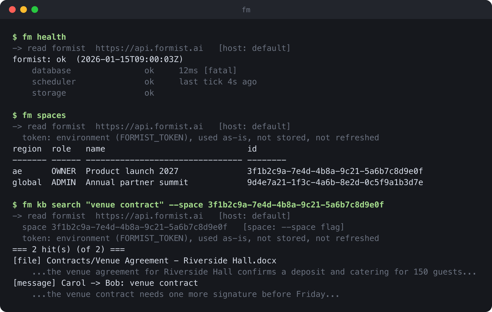

[English](README.md) · [简体中文](README.zh-CN.md) · **Français** · [العربية](README.ar.md)

# formist-cli

**`fm` est un client en ligne de commande pour les déploiements [Formist](https://formist.ai)
et [Evane](https://evane.ai), qui passe exactement par la même API et la même connexion que
l'application web.**



<sub>Données fictives, générées par le vrai code de `fm` avec `python3 scripts/render_screenshot.py`.</sub>

---

## Le problème

Faire tourner un déploiement Formist ou Evane au quotidien, c'est lui poser sans arrêt des
questions urgentes : cette région est-elle en bonne santé, un connecteur est-il bloqué, la
migration d'hier s'est-elle appliquée partout, à qui appartient tel espace parmi des dizaines.
Chaque question suppose normalement d'ouvrir l'application web, de trouver la bonne page
d'administration, ou d'écrire un script ad hoc contre l'API en gérant soi-même la connexion.
Ni l'un ni l'autre ne se scripte, et les deux sont lents au moment précis où il faut aller vite.

## L'idée

`fm` se connecte de la même façon que l'application web, donc il ne peut faire que ce que
votre propre compte peut déjà faire là-bas, rien de plus. Chaque commande affiche le
déploiement, l'espace et l'identifiant qu'elle a résolus avant de s'exécuter, pour que ce qui
est à l'écran soit l'information complète, pas une supposition. Une commande qui modifie des
données montre toujours d'abord ce qu'elle ferait ; valider est une étape à part, explicite.

- **Un seul client pour chaque déploiement.** `--host` bascule entre Formist, Evane, Evane EAU,
  Formist Chine, ou n'importe quelle origine personnalisée, comme un serveur de développement
  local, avec le même binaire et les mêmes commandes.
- **La provenance avant l'action.** Chaque commande annonce le déploiement et l'espace qu'elle
  a résolus, et d'où ils viennent : une option, une valeur par défaut mémorisée, ou rien du
  tout. Une mauvaise cible se repère en lisant l'écran, pas par ses conséquences.
- **Simulation par défaut.** Une commande qui modifie des données affiche d'abord ce qu'elle
  ferait et attend `--apply`. `fm participants dedupe`, qui fusionne un groupe de lignes en
  double, revérifie que le plan correspond toujours avant de valider, pour qu'une lecture
  périmée ne devienne jamais une écriture erronée.
- **Un identifiant par déploiement.** `fm login` enregistre un identifiant OAuth avec les
  droits `0600`, un fichier par déploiement, de sorte que se connecter à un environnement de
  test ne touche jamais la production. `FORMIST_TOKEN` en fournit un pour la CI : utilisé tel
  quel, jamais écrit sur disque, jamais rafraîchi.
- **Aucune dépendance surprise.** Uniquement la bibliothèque standard, Python 3.10 ou plus,
  une installation en une seconde.

## Installation

```sh
pipx install formist-cli
```

Python 3.10 ou plus récent. Aucune dépendance tierce.

## Utilisation

### Connexion

```sh
fm login            # opens a browser; the credential is stored at 0600
fm whoami
fm logout
```

Sur une machine sans navigateur, utilisez `fm login --no-browser` et collez le code affiché
par la page. Pour la CI, exportez `FORMIST_TOKEN` avec le champ `token` du fichier que
`fm login` écrit ; il est utilisé tel quel et jamais écrit sur disque.

Les identifiants vivent dans `~/.config/formist/` (remplaçable par `FORMIST_CONFIG_DIR`), un
fichier par déploiement, donc se connecter à l'un ne remplace jamais l'autre.

Les actions d'administration de la plateforme demandent un droit supplémentaire :
`fm login --admin` le demande, et le serveur ne l'accorde que si votre compte le possède déjà.
Sans cette option, même le jeton d'un administrateur de la plateforme ne fonctionne que comme
un utilisateur ordinaire.

### Choisir un déploiement

`fm` s'adresse par défaut à `https://api.formist.ai`. `--host` en choisit un autre :

| `--host`     | API                                  |
|--------------|---------------------------------------|
| `formist`    | `https://api.formist.ai` (défaut)    |
| `evane`      | `https://api.evane.ai`               |
| `evane-ae`   | `https://ae.api.evane.ai`            |
| `formist-cn` | `https://formist-api.we-carbon.com`  |

Toute autre valeur est prise comme une origine d'API, par exemple
`fm --host 127.0.0.1:8160 spaces` pour un serveur local. `--host` fonctionne avant ou après la
commande : `fm --host evane spaces` et `fm spaces --host evane` reviennent au même.

### Espaces

Un espace se désigne toujours par son identifiant, jamais par son nom, puisque les noms ne
sont pas uniques :

```sh
fm spaces                         # your own spaces
fm use --space <space-id>         # remember a default space
fm kb search "venue contract" --space <space-id>
```

`fm use` peut aussi mémoriser un déploiement, pour la lecture seulement. Une commande
d'écriture n'hérite jamais d'un déploiement mémorisé : nommez-le avec `--host`, sinon la
valeur par défaut (`formist`) est utilisée.

### Écritures

La plupart des commandes qui modifient des données s'exécutent d'abord en simulation et
affichent ce qu'elles feraient ; ajoutez `--apply` pour valider. `fm participants dedupe`, qui
fusionne un groupe de lignes en double, fonctionne un peu différemment : la simulation
affiche un jeton de plan, et `--apply <jeton>` relance la simulation pour confirmer que le plan
correspond toujours avant de valider. Quelques actions irréversibles, comme
`fm spaces --admin delete`, n'ont aucune simulation et le précisent dans leur propre `--help`.

### Commandes

Lancez `fm --help` pour la liste complète et `fm <commande> --help` pour chacune. Chaque
commande fonctionne avec les droits de votre propre compte, comme dans l'application web, et
le serveur revérifie chaque droit à chaque appel : `fm spaces` liste les espaces dont vous
êtes membre, `fm health` est public et ne demande aucune connexion, `fm doctor` récapitule
l'état de santé sur chaque déploiement, et le reste, `chats`, `chat`, `kb`, `get`, `export`,
`import`, `diff`, `upload`, `skill-attach`, `entity-fields`, `skill-library-install`,
`meeting`, `project`, `connector`, `skills-add`, `skills-update`, `proposals`, `audit-log`,
`connectors`, `files`, lit ou écrit votre propre espace de la même façon.

### Tâches (`fm task`)

`fm task` est un portage intégré du suivi des tâches et décisions de
[`nod`](https://github.com/wecarbon/noddit) : un nœud est une unité de travail, une tâche quand
un agent peut simplement la faire, une décision quand le responsable doit d'abord trancher. Il
fonctionne selon deux modes :

- **Déconnecté**, dans n'importe quel projet : `fm task init` crée un dossier `decisions/`, et
  chaque commande ci-dessous le retrouve en remontant depuis le répertoire courant, comme `git`
  retrouve `.git`. Rien ne quitte la machine.
- **Connecté**, avec `fm login` : `fm task --host <déploiement>` (ou un déploiement mémorisé par
  `fm use` avec un identifiant stocké) s'adresse à l'API de nœuds de cet espace à la place, pour
  qu'une équipe partage un seul suivi via Formist/Evane plutôt qu'un dossier par clone. Toutes
  les commandes n'ont pas encore de route côté serveur ; celles qui n'en ont pas le disent
  plutôt que de deviner.

```sh
fm task init                                  # creates decisions/ here
fm task add "Write the onboarding doc" --task # a new node
fm task start X1                              # to do -> in progress
fm task note X1 "found last year's draft"     # progress, without closing it
fm task show active                           # every open node (bare `show` lists only ones needing a decision)
fm task done X1 --note "doc is up"            # -> done
```

Une décision ressemble à la même chose, avec des options à la place de `--task` :

```sh
fm task add "Which domain for staging" -o 1="api-staging.example.com" -o 2="staging-api.example.com"
fm task push X2 1 --note "matches the cert"   # the owner's answer, recorded on the node
```

Chaque écriture a besoin d'un auteur : passez `--author "<vous> · <ce que vous faites>"`, ou
exportez `NODDIT_AUTHOR` une fois par session. `fm task whoami` indique sous quelle identité une
écriture signerait : le compte et l'espace connectés une fois que `fm login`/`--host` résout le
mode distant, sinon l'identité locale apposée sur chaque note. `fm task briefs` liste le travail
déposé par le responsable que personne n'a encore pris ; `fm task claim <ref>` en prend un.
Lancez `fm task --help` pour la liste complète des commandes et `fm task <commande> --help` pour
ses options.

#### Plugin Claude Code

Le dépôt git, pas le paquet `pipx`, est aussi un plugin Claude Code : `hooks/hooks.json` injecte
les règles d'usage de `fm task` et les nœuds encore ouverts du projet au début d'une session, et
`monitors/monitors.json` démarre `fm task monitor --here` pour que les réponses du responsable
atteignent l'agent sans qu'il ait à interroger en boucle. Il n'est pas publié sur un
marketplace, donc chargez-le depuis un clone plutôt que depuis le paquet installé :

```sh
git clone https://github.com/WeCarbon/formist-cli
claude --plugin-dir formist-cli
```

## FAQ

**Ai-je besoin des droits d'administration de la plateforme pour utiliser cet outil ?**
Non. Par défaut, chaque commande fonctionne avec les droits de votre propre compte, comme le
ferait l'application web pour ce compte : `fm spaces`, par exemple, liste les espaces dont
vous êtes membre. Quelques commandes acceptent aussi `--admin`, réservé à un compte
administrateur de la plateforme ; sans cette option, ou sans le droit correspondant, elles
sont refusées localement avant même l'envoi d'une requête, et c'est de toute façon le serveur
qui tranche en dernier ressort.

**Puis-je le pointer vers un serveur de développement local ?**
Oui : `--host` accepte n'importe quelle origine d'API, pas seulement les quatre déploiements
nommés, par exemple `fm --host 127.0.0.1:8160 health`.

**Puis-je l'utiliser en CI, sans navigateur ?**
Oui : exportez `FORMIST_TOKEN` avec le champ `token` du fichier que `fm login` écrit. Il est
relu à chaque appel, utilisé tel quel, et `fm` ne l'écrit jamais sur disque ni ne le rafraîchit.

**Qu'est-ce qui empêche une écriture d'atterrir sur le mauvais déploiement ?**
`fm use` ne mémorise un déploiement que pour la lecture ; une écriture résout toujours
`--host` depuis la ligne de commande, avec `formist` comme valeur par défaut si rien n'est
donné. Il n'existe pas d'« environnement courant » qu'une écriture pourrait hériter en
silence.

**`fm` peut-il faire quelque chose que mon compte ne pourrait pas faire dans l'application
web ?**
Non. Il appelle la même API avec le même identifiant, et le serveur applique chaque droit à
chaque appel ; `fm` n'est qu'une autre porte d'entrée vers elle, pas un autre ensemble de
droits.

## Développement

```sh
uv sync
uv run pytest
```

`docs/screenshot.png` est généré à partir d'une vraie sortie de `fm`, contre un serveur de
test local, jamais dessiné à la main :

```sh
python3 scripts/render_screenshot.py
```

## Licence

[MIT](LICENSE) © 2026 WeCarbon
