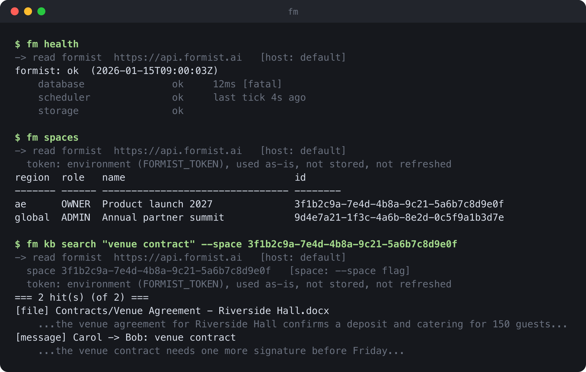

**English** · [简体中文](README.zh-CN.md) · [Français](README.fr.md) · [العربية](README.ar.md)

# formist-cli

**`fm` is a terminal client for [Formist](https://formist.ai) and [Evane](https://evane.ai)
deployments, over the exact same API and login the web app uses.**



<sub>Mock data, rendered by the real `fm` code with `python3 scripts/render_screenshot.py`.</sub>

---

## The problem

Keeping a Formist or Evane deployment running means asking it small, urgent questions all day:
is this region healthy, is a connector stuck, did yesterday's migration apply everywhere, which
of many spaces is this customer's. Each one normally means opening the web app and clicking
through an admin page, or writing a one-off script against the API and hand-rolling the login.
Neither is scriptable, and both are slow exactly when speed matters.

## The idea

`fm` signs in the same way the web app does, so it can only ever do what your own account is
allowed to do there, nothing more. Every command prints the deployment, space and credential it
resolved, before it runs, so what is on screen is the full picture, not a guess. A command that
changes data always shows what it would do first; committing is a separate, explicit step.

- **One client, every deployment.** `--host` switches between Formist, Evane, Evane UAE, Formist
  China, or any custom origin, such as a local dev server, same binary, same commands.
- **Provenance before action.** Every command announces which deployment and space it resolved,
  and where each came from, a flag, a remembered default, or nothing, so a wrong target is caught
  by reading the screen, not by its effect.
- **Dry run by default.** A command that changes data prints what it would do and waits for
  `--apply`. `fm update`, which applies a batch of changes at once, re-checks the plan still
  matches before committing, so a stale read can't turn into a wrong write.
- **A credential per deployment.** `fm login` stores an OAuth credential at `0600`, one file per
  host, so signing in to a staging deployment never touches production. `FORMIST_TOKEN` supplies
  one for CI: used as-is, never written to disk, never refreshed.
- **No surprise dependencies.** Standard library only, Python 3.10+, installs in a second.

## Install

```sh
pipx install formist-cli
```

Python 3.10 or newer. No third-party dependencies.

## Usage

### Sign in

```sh
fm login            # opens a browser; the credential is stored at 0600
fm whoami
fm logout
```

On a machine without a browser, use `fm login --no-browser` and paste the code the page shows.
For CI, export `FORMIST_TOKEN` with the `token` field of the file `fm login` writes; it is used
as-is and never written to disk.

Credentials live in `~/.config/formist/` (override with `FORMIST_CONFIG_DIR`), one file per host,
so signing in to one deployment never replaces another.

Platform-administration actions need an extra grant: `fm login --admin` requests it, and the
server only honours the request if your account already has it. Without that flag, a platform
admin's own token still runs as an ordinary user.

### Choosing a deployment

`fm` talks to `https://api.formist.ai` by default. `--host` picks another one:

| `--host`     | API                                  |
|--------------|---------------------------------------|
| `formist`    | `https://api.formist.ai` (default)   |
| `evane`      | `https://api.evane.ai`               |
| `evane-ae`   | `https://ae.api.evane.ai`            |
| `formist-cn` | `https://formist-api.we-carbon.com`  |

Anything else is taken as an API origin, for example `fm --host 127.0.0.1:8160 spaces` for a
local server. `--host` works before or after the command: `fm --host evane spaces` and
`fm spaces --host evane` are the same.

### Spaces

A space is always addressed by its id, never by its name, since names are not unique:

```sh
fm spaces                         # your own spaces
fm use --space <space-id>         # remember a default space
fm kb search "venue contract" --space <space-id>
```

`fm use` can also remember a host, for reads only. A command that writes never inherits a
remembered host: name it with `--host`, or the default (`formist`) is used.

### Writes

Most commands that change data run as a dry run first and print what they would do; add
`--apply` to commit. `fm update`, which applies a batch of changes transactionally, is slightly
different: the dry run prints a plan token, and `--apply <token>` re-runs the dry run to confirm
the plan still matches before committing. A handful of actions with no undo, such as `fm spaces
--admin delete`, have no dry run at all and say so in their own `--help`.

### Commands

Run `fm --help` for the full list and `fm <command> --help` for each one. Every command works
with your own account's permissions, the same as the web app, and the server re-checks every
permission on every call: `fm spaces` lists the spaces you belong to, `fm health` is public and
needs no login, `fm doctor` rolls health up across every deployment, and the rest, `chats`,
`chat`, `kb`, `get`, `export`, `import`, `diff`, `upload`, `skill-attach`, `entity-fields`,
`skill-library-install`, `meeting`, `project`, `connector`, `skills-add`, `skills-update`,
`proposals`, `audit-log`, `connectors`, `files`, read or write your own space the same way.

## FAQ

**Do I need platform-admin access to use this?**
No. Every command works with your own account's permissions by default, the same as the web app
would for that account: `fm spaces`, for example, lists the spaces you belong to. A few
commands also accept `--admin`, for a platform administrator account; without it, or without
the matching grant, they refuse locally before any request is sent, and the server still has
the final say either way.

**Can I point it at a local dev server?**
Yes: `--host` accepts any API origin, not only the four named deployments, for example
`fm --host 127.0.0.1:8160 health`.

**Can I use it in CI, without a browser?**
Yes: export `FORMIST_TOKEN` with the `token` field from the file `fm login` writes. It is read
fresh on every invocation, used as-is, and `fm` never writes it to disk or refreshes it.

**What stops a write from landing on the wrong deployment?**
`fm use` only remembers a host for reads; a write always resolves `--host` from the command
line, defaulting to `formist` if it is not given. There is no "current environment" for a write
to silently inherit.

**Will `fm` ever do something my account couldn't do in the web app?**
No. It calls the same API with the same credential, and the server enforces every permission on
every call; `fm` is a different front end for it, not a different set of rights.

## Development

```sh
uv sync
uv run pytest
```

`docs/screenshot.png` is generated from real `fm` output against a local mock server, never
handwritten:

```sh
python3 scripts/render_screenshot.py
```

## License

[MIT](LICENSE) © 2026 WeCarbon
