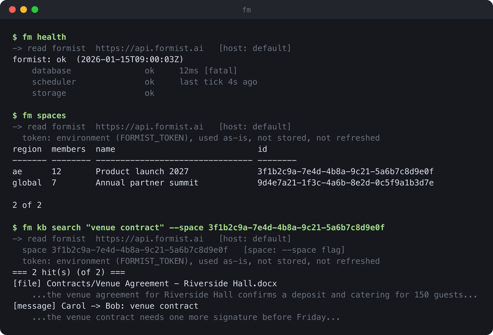

[English](README.md) · **简体中文** · [Français](README.fr.md) · [العربية](README.ar.md)

# formist-cli

**`fm` 是 [Formist](https://formist.ai) 和 [Evane](https://evane.ai) 部署的终端客户端,
走的是和网页版完全相同的 API 和登录方式。**



<sub>示例数据,用真实的 `fm` 代码通过 `python3 scripts/render_screenshot.py` 渲染而成。</sub>

---

## 问题

维护一个 Formist 或 Evane 部署,每天都要问它一些琐碎但紧急的问题:这个区域健康吗,
某个连接器是不是卡住了,昨天的迁移是不是所有地方都跑完了,这么多空间里哪个是这个
客户的。通常每一个问题都要打开网页版,点进管理页面找答案,或者写一个一次性脚本直
接调 API,还得自己处理登录。两种方式都不能写成脚本复用,偏偏越是要快的时候越慢。

## 思路

`fm` 用和网页版一样的方式登录,所以它能做的事,正好就是你这个账号在网页版能做的事,
不多也不少。每条命令执行前都会先打印它解析出来的部署、空间和凭证,所以屏幕上看到
的就是完整情况,不用猜。会改数据的命令,永远先把要做的事打印出来,提交是单独的、
明确的一步。

- **一个客户端,覆盖所有部署。** `--host` 在 Formist、Evane、阿联酋 Evane、中国区
  Formist,或任意自定义地址(比如本地开发服务器)之间切换,命令和用法完全一样。
- **先说清楚来源,再动手。** 每条命令都会报告它解析出的部署和空间,以及这些值是
  从哪里来的:一个参数、一个记住的默认值,还是什么都没有。目标选错了,看屏幕就能
  发现,不用等出了事才知道。
- **默认先试运行。** 会改数据的命令,先打印它会做什么,等着你传 `--apply`。批量
  改动命令 `fm update` 更进一步:提交前会重新核对这份计划是否还和刚才的试运行一
  致,防止一次过时的读取变成一次错误的写入。
- **凭证按部署分开存。** `fm login` 把 OAuth 凭证存成 `0600` 权限的文件,每个部署
  一个文件,登录测试环境绝不会动到生产环境。CI 场景用 `FORMIST_TOKEN` 提供凭证:
  读到就用,不落盘,不自动刷新。
- **没有意外的依赖。** 只用标准库,Python 3.10 以上,一秒装完。

## 安装

```sh
pipx install formist-cli
```

需要 Python 3.10 或更高版本。没有第三方依赖。

## 用法

### 登录

```sh
fm login            # opens a browser; the credential is stored at 0600
fm whoami
fm logout
```

没有浏览器的机器上,用 `fm login --no-browser`,把页面显示的码粘贴进去。CI 环境里,
把 `fm login` 写出的文件里 `token` 字段的值设成环境变量 `FORMIST_TOKEN` 即可;这个
值只会被读取使用,不会写入磁盘。

凭证存在 `~/.config/formist/`(可以用 `FORMIST_CONFIG_DIR` 改路径),每个部署一个
文件,所以登录一个部署不会替换掉另一个的凭证。

平台管理操作需要额外的授权:`fm login --admin` 会申请这个授权,但只有账号本身已经
拥有该权限,服务器才会批准。不加这个参数的话,哪怕本来是平台管理员,这个凭证也只
能当普通用户用。

### 选择部署

`fm` 默认访问 `https://api.formist.ai`。用 `--host` 可以切到别的部署:

| `--host`     | API                                  |
|--------------|---------------------------------------|
| `formist`    | `https://api.formist.ai`(默认)      |
| `evane`      | `https://api.evane.ai`               |
| `evane-ae`   | `https://ae.api.evane.ai`            |
| `formist-cn` | `https://formist-api.we-carbon.com`  |

其他任何值都会被当成一个 API 地址,比如连本地服务器用
`fm --host 127.0.0.1:8160 spaces`。`--host` 放在命令前后都可以:
`fm --host evane spaces` 和 `fm spaces --host evane` 是一回事。

### 空间

空间永远用它的 id 来指定,不能用名字,因为名字不保证唯一:

```sh
fm spaces                         # every space, platform-admin only
fm use --space <space-id>         # remember a default space
fm kb search "venue contract" --space <space-id>
```

`fm use` 也可以记住一个 host,但只在读操作里生效。写操作永远不会继承记住的 host:
要么用 `--host` 显式指定,要么就用默认值 `formist`。

### 写操作

大多数会改数据的命令都会先试运行,打印出它会做什么;加上 `--apply` 才会真正提交。
`fm update` 稍微不一样,它会批量提交一组改动:试运行会打印一个计划令牌(plan
token),`--apply <令牌>` 会重新跑一次试运行,确认这份计划还和当初一致,然后才提
交。少数不可撤销的平台管理操作,比如 `fm spaces delete`,根本没有试运行这一步,
各自的 `--help` 里会写清楚。

### 命令

完整命令列表看 `fm --help`,每条命令的细节看 `fm <command> --help`。这些命令分成
两类:一类只用到你这个账号本身的权限,和网页版一样;另一类还需要平台管理员权限,
服务器每次调用都会重新核实。

日常使用,只看账号本身权限:`chats`、`chat`、`kb`、`get`、`export`、`import`、
`diff`、`upload`、`skill-attach`、`entity-fields`、`skill-library-install`、
`meeting`、`project`、`connector`、`skills-add`、`skills-update`。

平台管理,需要额外授权:`spaces`、`users`、`proposals`、`audit-log`、`connectors`、
`logs`、`space-plan`、`usage-tokens`、`alerts`、`settings`、`messages`、
`whatsapp`、`update`、`airtable`、`participants`、`instance`。

`fm health` 不需要登录就能用,除非加 `--admin` 看跨区域视图;`fm doctor` 也不需
要管理员权限。`fm files` 比较特殊,读取和重新评估是日常权限,合并两条重复记录则
需要平台管理员权限。

## 常见问题

**用这个工具需要平台管理员权限吗?**
不需要。用普通账号登录,能跑的那部分命令和网页版给这个账号的权限完全一致。如果
`fm login` 当时已经记下这个凭证没有管理员权限,跑一个需要管理员权限的命令会在本
地就被拒绝,并说明缺的是哪个权限,请求都不会发出去;如果权限状态不确定,最终还
是由服务器说了算,和网页版一样。

**能不能指向本地开发服务器?**
可以。`--host` 接受任意 API 地址,不只是那四个预设部署,比如
`fm --host 127.0.0.1:8160 health`。

**能不能在 CI 里用,不走浏览器登录?**
可以。把 `fm login` 写出的文件里 `token` 字段的值设成环境变量 `FORMIST_TOKEN`。
每次调用都会重新读取这个值,读到就用,`fm` 既不会把它写入磁盘,也不会自动刷新。

**什么机制能防止写操作发到错的部署上?**
`fm use` 记住的 host 只在读操作里生效;写操作永远从命令行解析 `--host`,不传就
用默认值 `formist`。写操作没有"当前环境"这种东西可以让它悄悄继承。

**`fm` 会不会做出这个账号在网页版做不到的事?**
不会。它调用的是同一个 API,用的是同一个凭证,每次调用服务器都会重新核实权限;
`fm` 只是换了一个入口,权限范围没有任何变化。

## 开发

```sh
uv sync
uv run pytest
```

`docs/screenshot.png` 是从真实的 `fm` 输出渲染出来的,连接一个本地模拟服务器,不
是手画的:

```sh
python3 scripts/render_screenshot.py
```

## 许可证

[MIT](LICENSE) © 2026 WeCarbon
